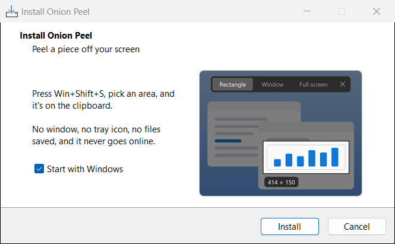
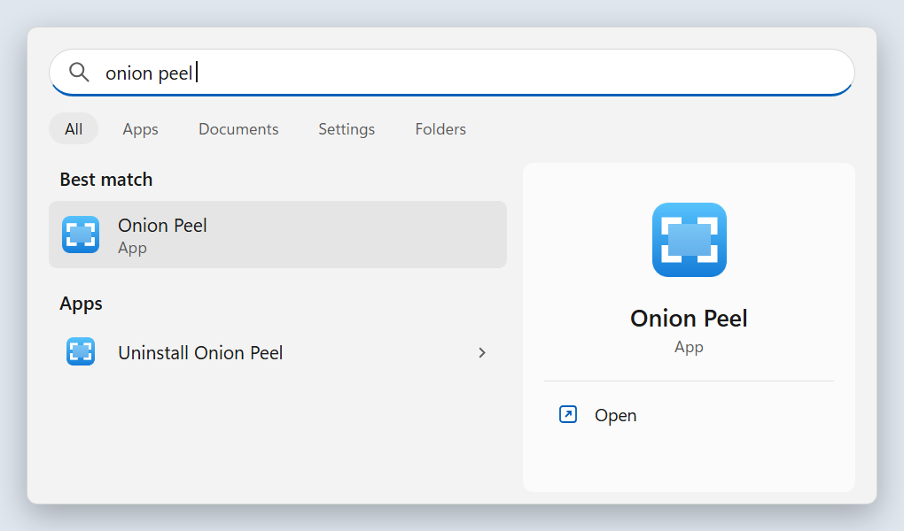

# Onion Peel

Peel a piece off your screen. Press **Win+Shift+S**, pick an area, and it's on the
clipboard. That's all it does.

- No window, no tray icon, no history, no files saved.
- No network: it never connects to the internet.
- Freezes the screen first, so menus and tooltips stay put while you pick.
- Works over fullscreen games and on every monitor, HDR included.

<!-- release -->
Version **1.0.2** · [VirusTotal: 71 of 71 clean](https://www.virustotal.com/gui/file/7f8c18023348e9ae3c2591e18983f0f434706986dc1ca41fd4668b195c84d098) · [latest release](https://github.com/Onion-Alien/onion-peel/releases/latest)
<!-- /release -->

## Why

Reason for creating this:

- The Windows Snipping Tool has bad reliability.
- Similar tools were too bulky or had network/history built in.

## Install



Download `OnionPeelSetup.exe` from the [latest release](https://github.com/Onion-Alien/onion-peel/releases/latest)
and run it. Choose whether Onion Peel should start with Windows and press **Install**.
No admin rights needed.

The installer isn't code-signed yet, so Windows SmartScreen may warn the first time: choose
**More info**, then **Run anyway**. Every release is scanned on VirusTotal (the link is at
the top) and lists the installer's SHA-256, so you can check the download with
`Get-FileHash OnionPeelSetup.exe`, or build it yourself (below).

Onion Peel starts as soon as it's installed. If you untick **Start with Windows**, start it
yourself after a restart: search the Start menu for **Onion Peel**.
**Uninstall Onion Peel** is right there too (or use Settings > Apps > Installed apps).

<picture>
  <source media="(prefers-color-scheme: dark)" srcset="docs/start-menu-dark.png">
  
</picture>

Running a newer `OnionPeelSetup.exe` updates it.

## Use

| Key or action | What it does |
|---|---|
| Win+Shift+S | Freeze the screen and open the snip bar |
| Drag | Snip a rectangle (Rectangle mode) |
| Click | Snip the window or monitor under the mouse (Window / Full screen mode) |
| 1, 2, 3 | Rectangle, Window, Full screen |
| Alt+Tab | Bring another window to the front; the picture is retaken with it |
| Right-click | Drop a drag in progress, otherwise close |
| Esc | Close without snipping |

The snip goes to the clipboard only; paste it anywhere.

## Limits

- Windows drops a game in exclusive fullscreen to the desktop when any window opens over
  it, Snipping Tool's too. So over such a game Win+Shift+S only takes the picture, and the
  game keeps running; the snip screen opens with that picture once you Alt+Tab out or the
  game closes. Pressing it again before then takes a newer picture. Borderless fullscreen
  games get the snip screen right away.
- On HDR screens, light brighter than SDR white is clipped.
- The snip screen is left out of screen recordings and shares (OBS, Discord).

## Build

Rust (stable) on Windows:

```
cargo build --release
```

The exe is `target/release/onion-peel.exe`. To build the installer too, run
`powershell -File scripts/build-release.ps1` (needs Inno Setup 6.7 or newer);
`python scripts/vt_scan.py target/installer/OnionPeelSetup.exe` then scans it on VirusTotal
(it needs a free API key; the script says where to put it). See
[CONTRIBUTING.md](CONTRIBUTING.md) for the self-test and the privacy checks.

## License

[GPL-3.0](LICENSE).
